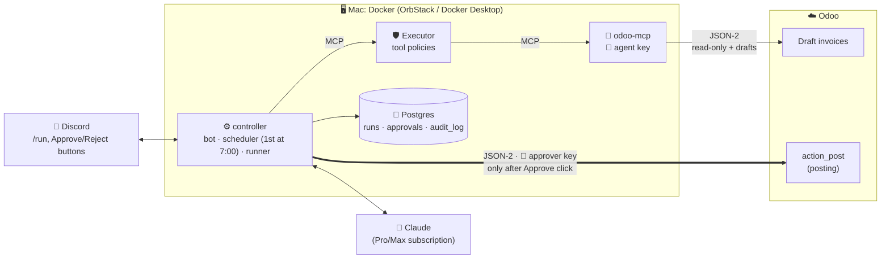

# MGE Agents: F0 on a Mac

F0 goal: **monthly invoices prepared automatically, posted only after approval in Discord.**



| Component | Where it runs | Access |
|---|---|---|
| controller, Executor, odoo-mcp, **Postgres** | Docker on the Mac (later a mini PC, step 11) | Postgres and odoo-mcp have no published ports; they are reachable only inside the Docker network. The Executor UI is on `127.0.0.1:4788`. |
| Postgres data | Docker volume `mge-agents_pgdata` | Survives `docker compose down`; only `down -v` deletes it. |
| Claude, Discord, Odoo | External services | Over the internet. |

**Key security property:** the agent has no posting tool at all. The agent's Odoo key lives only in `odoo-mcp`, and the posting key lives only in `controller`. Posting happens deterministically in code, not in the LLM, and only after you click.

---

## 0. Before you start

| Check | Why |
|---|---|
| **Odoo plan** | On Odoo Online, the external API (JSON-2) is available only on the **Custom** plan (not on One App Free or Standard). This restriction does not apply to Odoo.sh or on-prem. |
| **Agent license** | The "Invoicing Agent" user is an internal user, which means an extra seat in Odoo. |
| **Mac must not sleep** | If the Mac is asleep on the 1st of the month at 7:00, the schedule does not run. In F0 that is acceptable (run it manually with `/run`). For a reliable schedule, the answer is a mini PC (step 11). |
| **Test environment** | Do the first run against an Odoo staging/test database if you have one. |

---

## 1. Tools on the Mac

```bash
# Homebrew (if you don't have it yet)
/bin/bash -c "$(curl -fsSL https://raw.githubusercontent.com/Homebrew/install/HEAD/install.sh)"

# Docker runtime: OrbStack (lighter) OR Docker Desktop
brew install --cask orbstack        # or: brew install --cask docker

brew install git
```

Start OrbStack or Docker Desktop and check: `docker compose version`.
In Docker Desktop, allocate at least **4 GB RAM** (Settings → Resources).

---

## 2. Repo

```bash
mkdir -p ~/Projects && cd ~/Projects
unzip ~/Downloads/mge-agents.zip        # or copy the folder
cd mge-agents
git init && git add . && git commit -m "F0: agent platform foundation"
cp .env.example .env                    # .env is in .gitignore
```

Structure:

```
mge-agents/
├── compose.yaml
├── .env.example
├── db/init.sql                       # runs, approvals, audit_log (append-only)
├── agents/odoo-invoicing/
│   ├── agent.yaml                    # model, schedule, limits
│   ├── CLAUDE.md                     # agent instructions
│   └── customers.yaml                # WHO gets invoiced and for WHAT
├── services/
│   ├── odoo-mcp/                     # MCP server: read-only + drafts
│   └── controller/                   # Discord bot, scheduler, runner, approvals
└── logs/                             # error logs of failed runs
```

If you want a remote repo: create a private `mge-agents` on GitHub and run `git remote add origin … && git push -u origin main`.

---

## 3. Claude subscription (Pro/Max)

The agent runs on your Claude subscription, not on an API key. The controller uses the Claude Agent SDK, which runs Claude Code under the hood, and Claude Code can use a subscription token.

1. On the Mac (Claude Code must be installed and logged in with your subscription):
   ```bash
   claude setup-token
   ```
   It opens a browser to log in and prints a long-lived token (`sk-ant-oat01-…`).
2. In `.env`: `CLAUDE_CODE_OAUTH_TOKEN=sk-ant-oat01-…`
3. **Do not set `ANTHROPIC_API_KEY`**: it takes precedence over the token, and the run would be billed through the API.

What this means:
- Runs consume the **same subscription limits** as your interactive Claude Code usage. If you are at your limit at 7:00 on the 1st, the run fails with an error.
- The "run cost" in Discord is only an **estimate at API prices**, not an actual bill.
- The token is tied to your account. If it is revoked or expires, run `claude setup-token` again.
- **Terms of use:** Anthropic does not allow third-party products to offer users claude.ai login. For internal automation on your own subscription this is not clearly defined. For business use (SunContract), an API key or a Team/Enterprise plan is the safer choice. Check before going to production.

---

## 4. Odoo

### 4.1 Agent user
1. Settings → Users → **New**: name `Invoicing Agent`, email e.g. `invoicing-agent@suncontract.org`.
2. Access rights: **Invoicing: Billing** (create invoices). Nothing else (no Settings, no Sales/CRM admin).
3. Save, and copy the ID from the URL (`…/odoo/users/42`) into `.env` → `ODOO_AGENT_USER_ID=42`.

### 4.2 API keys
- **Agent:** log in as Invoicing Agent (in a private window) → My Preferences → Account Security → **New API Key** → `ODOO_AGENT_API_KEY`.
- **Approver (you):** same on your own user → `ODOO_APPROVER_API_KEY`.
- Odoo does not allow keys valid for longer than **3 months**. Set yourself a rotation reminder.
- `ODOO_URL` (e.g. `https://suncontract.odoo.com`) and `ODOO_DB` (database name).

### 4.3 Key test
```bash
source .env
curl -sS "$ODOO_URL/json/2/res.partner/search_read" \
  -H "Authorization: bearer $ODOO_AGENT_API_KEY" \
  -H "X-Odoo-Database: $ODOO_DB" \
  -H "Content-Type: application/json" \
  -d '{"domain":[["is_company","=",true]],"fields":["name"],"limit":3}'
```
Expected: JSON with three customers. `401 Invalid apikey` means a wrong key; 403/404 means a plan or URL problem.

### 4.4 customers.yaml
Edit `agents/odoo-invoicing/customers.yaml`: exact customer and product names as they appear in Odoo, plus quantities and prices.

---

## 5. Discord

1. https://discord.com/developers/applications → **New Application** `MGE Agents`.
2. **Bot** → Reset Token → `DISCORD_BOT_TOKEN`. No privileged intents are needed.
3. **OAuth2 → URL Generator**: scopes `bot`, `applications.commands`; permissions `Send Messages`, `Embed Links`, `Read Message History`. Open the URL and add the bot to the **MGE** server.
4. Create a `#approvals` channel on the server.
5. Discord → Settings → Advanced → **Developer Mode** ON, then right-click → *Copy ID*:
   - server → `DISCORD_GUILD_ID`
   - `#approvals` channel → `DISCORD_APPROVAL_CHANNEL_ID`
   - your profile → `DISCORD_APPROVER_IDS`

---

## 6. Start Postgres, Executor, odoo-mcp

Also set `POSTGRES_PASSWORD` in `.env`, then:

```bash
docker compose up -d --build postgres executor odoo-mcp
docker compose ps                     # all "running"/"healthy"
docker compose logs odoo-mcp --tail 20
```

---

## 7. Executor: integration, policies, key

Open **http://localhost:4788**.

1. **Add integration → MCP server**
   - namespace/name: `odoo`
   - URL: `http://odoo-mcp:8000/mcp` (the service name on the Docker network, not `localhost`)
   - No authentication, because odoo-mcp is reachable only inside the Docker network.
2. **Policies** (for each tool of the `odoo` integration):

   | Tool | Policy |
   |---|---|
   | `find_partners`, `find_products`, `list_invoices`, `get_invoice_lines` | allow |
   | `create_draft_invoice` | allow (creates a draft only; human control happens in Discord) |

   Do not set "require approval": an Executor approval would pause the run and wait in Executor's UI, not in Discord.
3. **MCP client key:** in the workspace settings, create an API key/token for the MCP client → `.env`: `EXECUTOR_TOKEN=…`
   The controller sends it as `Authorization: Bearer <token>`. If the self-hosted UI requires a different header, adjust `headers` in `services/controller/app/runner.py`.
4. Test: in the Executor UI, run `odoo.find_partners` with `{"name": "d.o.o."}` and check that it returns customers.

---

## 8. Start the controller

```bash
docker compose up -d --build controller
docker compose logs -f controller
```
Expected in the log:
```
Schedule: odoo-invoicing -> 0 7 1 * *
Controller ready as MGE Agents#1234
```

---

## 9. First test

1. In Discord: `/run agent:odoo-invoicing`
   (optionally `instructions: only customer Primer d.o.o.` for a narrow first test)
2. In `#approvals` you will see:
   - `▶️ odoo-invoicing run #1 started`
   - after a few minutes, an embed with the drafts (customer, amount, id), the agent's report, the cost, and the **Approve posting** / **Reject** buttons
3. Check the drafts in Odoo (Invoicing → Customers → Invoices → filter *Draft*). Open at least one.
4. Click **Approve posting** → `✅ Posted N invoices: INV/2026/…`
5. **Idempotency test:** run `/run` again. The agent must skip all customers ("already exists").

Database inspection:
```bash
docker compose exec postgres psql -U mge -d mge -c \
 "select id, agent, status, cost_usd, started_at from runs order by id desc limit 5;"
docker compose exec postgres psql -U mge -d mge -c \
 "select at, actor, event from audit_log order by id desc limit 10;"
```

---

## 10. Troubleshooting

| Symptom | Cause / fix |
|---|---|
| `/run` does not appear in Discord | Wrong `DISCORD_GUILD_ID`, or the bot was not invited with the `applications.commands` scope. Restart the controller. |
| Agent cannot see tools | Wrong `EXECUTOR_TOKEN` or URL. `docker compose logs executor`. In the Executor UI, check that the `odoo` integration is active. |
| `Odoo … HTTP 401` | The key has expired (max 3 months) or is wrong. |
| Drafts exist but no embed | `ODOO_AGENT_USER_ID` does not match the user whose key odoo-mcp uses. |
| `❌ run failed` | The full traceback is in `logs/run-<id>-<agent>.log` and in the `runs.error` column. |
| Buttons don't work after a restart | They should (the custom_id is handled on every click). If not, check that your ID is in `DISCORD_APPROVER_IDS`. |

Stop or upgrade:
```bash
docker compose down                       # data stays in the volumes
git pull && docker compose up -d --build  # upgrade
```

---

## 11. Moving to a mini PC (once F0 works)

```bash
# on the Mac: back up Executor (SQLite + encryption keys!) and Postgres
mkdir -p backups
docker run --rm -v mge-agents_executor-data:/data -v "$PWD/backups":/b alpine \
  tar czf /b/executor-data.tgz -C /data .
docker compose exec -T postgres pg_dump -U mge mge > backups/mge.sql

# on the mini PC (Linux + Docker): git clone, copy over .env and backups/, then:
docker compose up -d postgres
docker run --rm -v mge-agents_executor-data:/data -v "$PWD/backups":/b alpine \
  tar xzf /b/executor-data.tgz -C /data
docker compose exec -T postgres psql -U mge mge < backups/mge.sql
docker compose up -d --build
```
Then run `docker compose down` on the Mac. **Only one** controller may run at a time, otherwise you get duplicate schedules.

---

## What F0 deliberately doesn't have yet (coming in F1)

- the runner runs inside the controller (F1: ephemeral container per run)
- secrets in `.env` (F1: Infisical/Vault)
- no Langfuse/Grafana (F1)
- the queue is an in-memory `running` set, one run per agent at a time (F1: Postgres queue)
